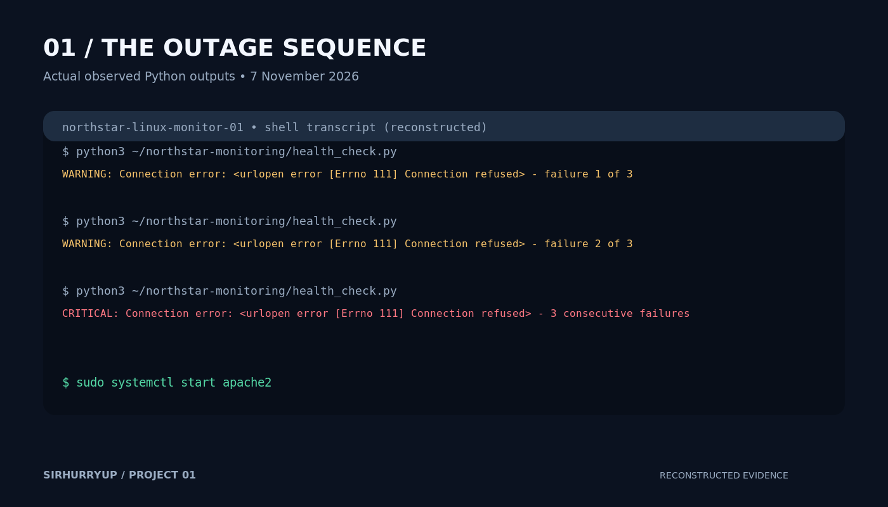
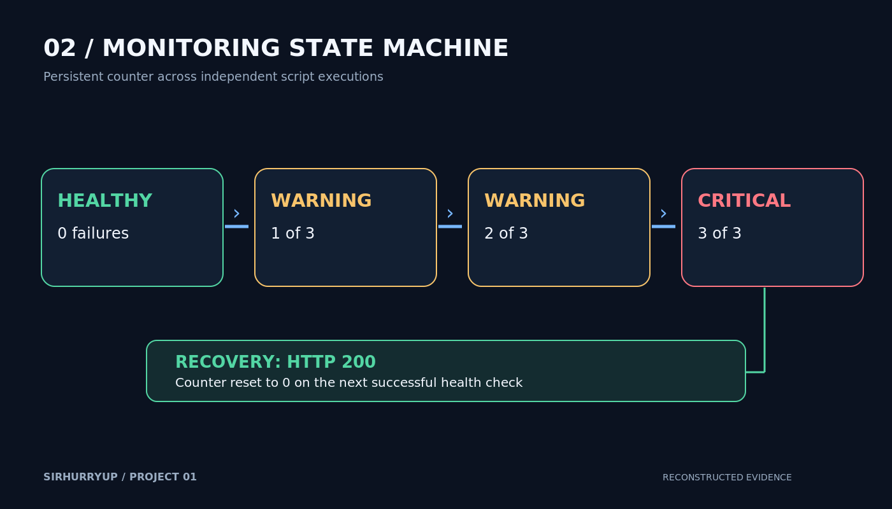
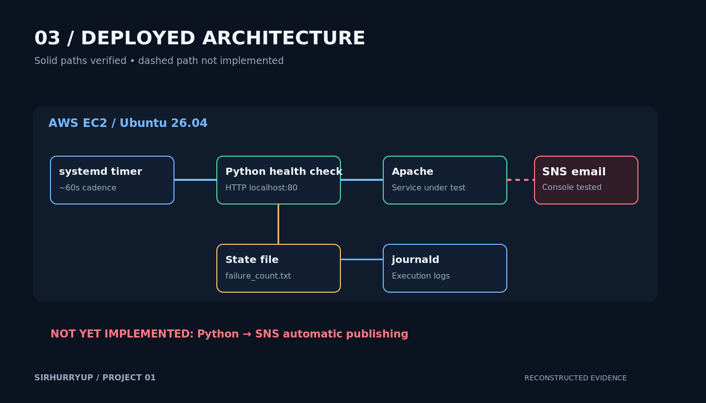
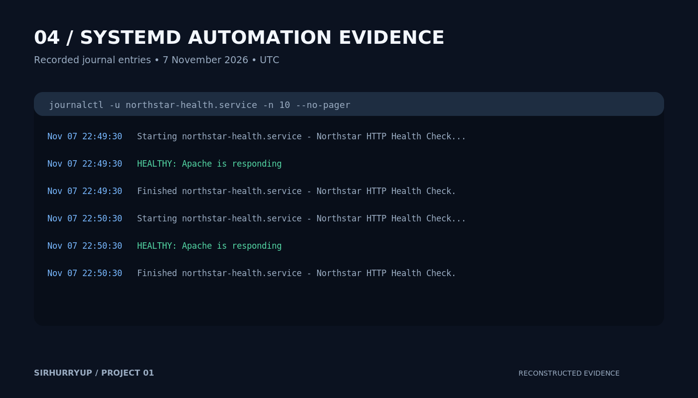

# Project 01 — The Linux Server Nobody Was Watching

**SirhurryUp Cloud Engineering Accelerator | Break the Mold (BTM)**

A fictional customer scenario (Northstar Business Services) used to practice production-minded Linux operations: detecting an Apache outage, persisting failure state, escalating after three consecutive failed checks, and confirming recovery.

## Verified results

- Python HTTP check returned `HEALTHY: Apache is responding` and exit code `0` while Apache was running.
- With Apache intentionally stopped, three independent executions reported WARNING 1/3, WARNING 2/3, then CRITICAL 3/3.
- Restarting Apache produced HEALTHY and reset `/var/lib/northstar-monitoring/failure_count.txt` to `0`.
- systemd timer was active; journal showed successful checks at **22:49:30** and **22:50:30 UTC, 7 November 2026**.
- An SNS console-published test email reached the confirmed subscriber.
- EC2 instance was stopped at the end of the lab.

**Important limitation:** Automatic Python-to-SNS publishing was **not implemented or verified**. The end-to-end five-minute IT notification objective is **not met** by the available evidence. The `CRITICAL` journal message is not an email alert.

## Visual evidence

Images are **reconstructions from recorded session outputs**, not screenshots captured directly from the EC2 desktop or AWS Console.

## Repository contents

- `systemd/`: tested service and timer definitions; the existing timer name `northstart-health.timer` is preserved intentionally.
- `docs/implementation-log.md`: decisions and debugging narrative.
- `docs/test-results.md`: evidence and acceptance status.
- `docs/architecture.md`: deployed system and outstanding integration.
- `images/`: publication-quality PNGs and editable SVG sources.

**Source-code reconciliation:** The actual working `scripts/health_check.py` lives in the existing GitHub repository and local checkout. This publication pack intentionally does **not** replace it with a guessed reconstruction. Preserve the tested source file when integrating these materials.

## Operating notes

The timer executes the oneshot service roughly every minute. The script checks `http://localhost` with a five-second timeout, stores the consecutive failure count in `/var/lib/northstar-monitoring/failure_count.txt`, and writes results to stdout captured by journald. The persistent state directory was provisioned with ownership `ssm-user:ssm-user` and mode `700`.

For a future production release, implement and validate automatic notification delivery, alert deduplication, and the five-minute end-to-end objective.
