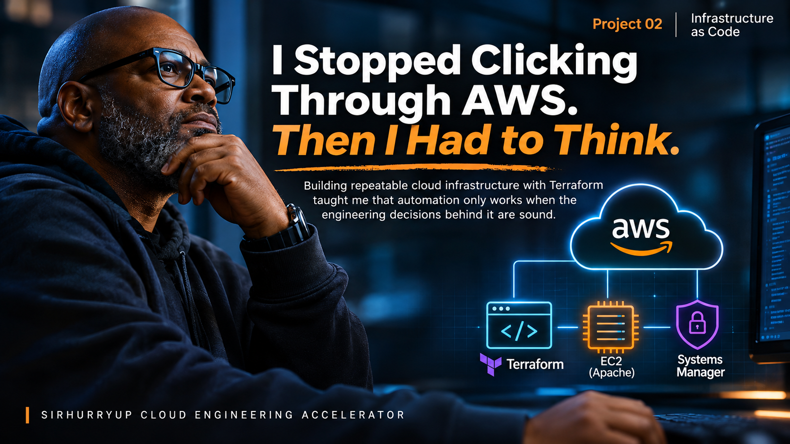

# Project 02 — Northstar Infrastructure as Code

## Business Problem

Northstar needs a repeatable way to deploy and manage its AWS web infrastructure without relying on manual configuration through the AWS Management Console.

Manual infrastructure provisioning introduces configuration inconsistencies, increases deployment effort, and makes recovery difficult.

## Engineering Objective

I designed and deployed a small AWS web environment using Terraform to demonstrate repeatable infrastructure provisioning, secure administrative access, application verification, and controlled resource lifecycle management.

## Architecture

My Terraform configuration provisions:

- An AWS VPC (`10.20.0.0/16`)
- A public subnet (`10.20.1.0/24`)
- An internet gateway and public route table
- A security group allowing inbound HTTP on port 80
- An EC2 `t2.micro` instance running Ubuntu 22.04
- An IAM role and instance profile for AWS Systems Manager
- Apache installed and configured through EC2 user data

The application is publicly accessible over HTTP. Administrative access uses AWS Systems Manager Session Manager rather than inbound SSH.

## Engineering Decisions

**Terraform:** I chose Infrastructure as Code to make deployments reproducible and reduce manual configuration.

**Network design:** I created a dedicated VPC and subnet to isolate the Northstar environment from unrelated AWS workloads.

**Administrative access:** I used Session Manager instead of exposing SSH port 22 to the internet.

**Bootstrap automation:** I used EC2 user data to install Apache and deploy a basic web page automatically.

**Resource dependencies:** I used Terraform resource references to establish relationships without hardcoding AWS resource IDs.

## Verification and Test Evidence

| Test | Result |
|---|---|
| Terraform configuration validation | Passed |
| Initial infrastructure deployment | 12 resources created |
| HTTP application response | HTTP 200 OK |
| Systems Manager registration | Online |
| Controlled Apache outage | HTTP connection failed as expected |
| Manual Apache recovery | HTTP 200 OK restored |
| Terraform destruction | 12 resources destroyed |
| Terraform rebuild | 12 resources recreated |
| Rebuilt application verification | HTTP 200 OK |
| Rebuilt SSM verification | Online |
| Final infrastructure cleanup | 12 resources destroyed |

## Security Considerations

I restricted inbound traffic to HTTP port 80 and avoided opening SSH port 22.

I attached the AWS-managed `AmazonSSMManagedInstanceCore` policy to the EC2 instance role for Systems Manager connectivity.

The demonstration application uses HTTP. A production deployment would require HTTPS, tighter network controls, additional monitoring, and further IAM review.

## Failure and Recovery

I simulated an application failure by stopping Apache on the EC2 instance.

An external HTTP request failed, confirming the outage was observable.

I restarted Apache manually and verified that HTTP connectivity returned.

This test demonstrated failure detection and manual recovery. It did not demonstrate automated self-healing.

## FinOps and Lifecycle Management

I selected a small EC2 instance for the demonstration and destroyed the Terraform-managed infrastructure after testing to reduce unnecessary AWS charges.

I recognize that EC2 compute, public IPv4 addresses, EBS storage, and data transfer can contribute to operating costs.

## Reproducibility

I successfully destroyed and recreated all 12 Terraform-managed AWS resources using the same configuration.

The rebuilt environment received new AWS resource identifiers while preserving the intended infrastructure design.

I verified both application availability and Systems Manager connectivity after rebuilding.

## Lessons Learned

- Infrastructure as Code requires careful management of state files and credentials.
- Terraform resource references reduce dependence on manually assigned AWS identifiers.
- AWS CLI authentication and Terraform provider authentication must be understood and verified.
- Successful provisioning does not automatically prove application availability.
- Failure testing and rebuilding provide stronger engineering evidence than deployment alone.
- Infrastructure cleanup is an important part of responsible cloud operations.